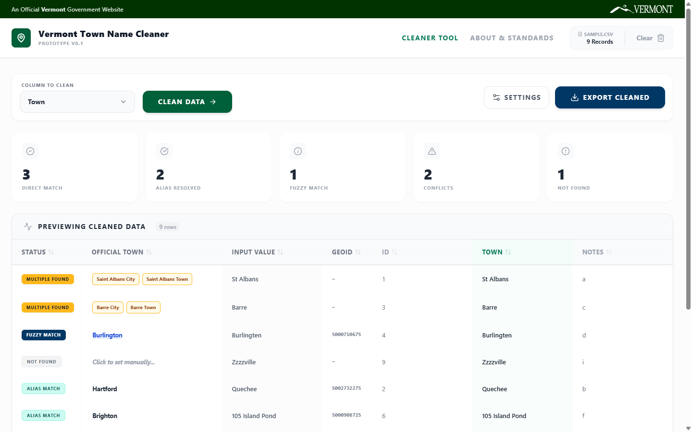

# Vermont Town Name Cleaner

[](https://github.com/VCGI/vt-town-name-cleaner/actions/workflows/ci.yml)
[](LICENSE)

A web utility that standardizes messy Vermont town names against official state geographic identifiers. It combines a curated alias table with fuzzy matching to resolve inconsistent entries to their official municipalities.

**[Open the live app](https://map.vermont.gov/town-name-cleaner/)**



## Features

-   **Excel & CSV support**: Drag and drop `.xlsx`, `.xls`, or `.csv` files.
-   **Intelligent matching**: Combines an alias lookup with Jaro-Winkler fuzzy matching to handle typos, abbreviations, addresses, and village names (e.g., "Quechee" resolves to "Hartford").
-   **Interactive resolution**:
    -   **Exact match**: Validated against the official town list.
    -   **Alias**: Maps historical names and villages to towns.
    -   **Fuzzy**: Auto-corrects minor spelling errors.
    -   **Ambiguous**: Flags names that could refer to more than one municipality (e.g., "Barre" is a city and a town) and lets you choose.
-   **Data enrichment**: Optionally append official GEOIDs, county, RPC, and agency codes to the output.
-   **Performance**: Matching runs in a Web Worker and large tables are virtualized, so big datasets don't freeze the UI.
-   **Privacy**: All processing happens in your browser. Your data is never uploaded.

## Getting started

### Prerequisites

-   Node.js 20.19 or later
-   npm

### Install and run

```bash
git clone https://github.com/VCGI/vt-town-name-cleaner.git
cd vt-town-name-cleaner
npm install
npm run dev
```

The app runs at `http://localhost:5173`.

### Scripts

| Command | Description |
| --- | --- |
| `npm run dev` | Start the development server |
| `npm run build` | Typecheck and create a production build in `dist/` |
| `npm run preview` | Serve the production build locally |
| `npm run typecheck` | Run the TypeScript compiler without emitting files |
| `npm test` | Run the test suite in watch mode (`npm run test:run` for a single run) |
| `npm run coverage` | Run tests with a coverage report |

## Reference data

The matcher uses [`data/vt-town-alias.json`](data/vt-town-alias.json), which is bundled into the app at build time. It has two parts:

-   `towns`: official municipalities keyed by name, with GEOID, county, RPC, and agency codes.
-   `aliases`: lowercase alternate names mapped either to an official town name or to an `{ "type": "ambiguous", "options": [...] }` entry.

To add or correct an alias, edit the `aliases` object (keys must be lowercase) and run `npm run test:run`. A regression test checks that every alias in the file resolves to its target.

Town boundaries and related datasets come from the Vermont Center for Geographic Information (VCGI):

-   **Town boundaries**: [Vermont Open Geodata Portal](https://geodata.vermont.gov/datasets/3f464b0e1980450e9026430a635bff0a_0/)
-   **Alias table**: A curated list of villages, hamlets, and historical names mapped to official towns.

## Documentation

See [docs.md](docs.md) for the architecture and matching pipeline.

## Security

Please report vulnerabilities privately. See [SECURITY.md](SECURITY.md).

## License

Released under the [MIT License](LICENSE).
